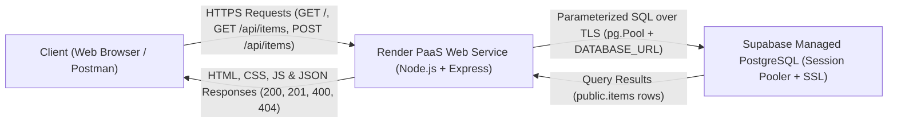

# Cloud & PaaS Reflection — BatStateWall

**Course:** IT 412 — Platform Technologies  
**Institution:** Batangas State University — The National Engineering University (JPLPC Malvar Campus, College of Informatics and Computing Sciences)  
**Architecture:** Render (PaaS Web Service) · Node.js & Express · Supabase (Managed PostgreSQL)

---

## 1. Cloud Model Justification: Why PaaS (Render) Over IaaS

When deploying a cloud-native web application like **BatStateWall**, selecting **Platform as a Service (PaaS)** through **Render** provides significant operational and engineering advantages over **Infrastructure as a Service (IaaS)** virtual machines (such as AWS EC2 or Google Compute Engine). With IaaS, the developer acts as a full system administrator: provisioning virtual machines, configuring Linux firewalls, installing and updating the Node.js runtime, setting up reverse proxies (like Nginx), managing SSL/TLS certificates, configuring process supervisors (such as PM2), and manually installing, patching, and backing up a database server.

By choosing **Render** as a PaaS provider alongside **Supabase** as a managed cloud database, those underlying infrastructure responsibilities are offloaded to specialized cloud platforms. Render connects directly to the project's GitHub repository, runs automated builds (`npm install`), launches the application (`npm start`), automatically provisions HTTPS/TLS encryption on a public `.onrender.com` URL, and binds incoming traffic to the port injected via `process.env.PORT`. Sensitive credentials such as `DATABASE_URL` are managed securely through Render's Environment Variables dashboard rather than being committed to source control.

Similarly, **Supabase** manages PostgreSQL availability, storage, connection pooling (via the Session Pooler), and encrypted TLS transport (`ssl: { rejectUnauthorized: false }`). Adopting PaaS allows the development team to focus completely on application correctness and security—such as server-side input trimming and length validation, parameterized SQL queries (`$1`, `$2`) to prevent SQL injection, proper HTTP status codes (`200`, `201`, `400`, `404`, `500`), and XSS-safe frontend rendering—resulting in faster, safer, and more maintainable cloud deployment.

---

## 2. Shared Responsibility Model (IaaS vs. BatStateWall on PaaS)

| Layer / Responsibility | Traditional IaaS (Virtual Machine) | BatStateWall on PaaS (Render + Supabase) |
|---|---|---|
| **Application Code, REST API & Validation** | Developer | **Developer** (`server.js`, `public/`) |
| **Database Schema & User Data** | Developer | **Developer** (`schema.sql`, `items` table) |
| **Environment Secrets (`DATABASE_URL`)** | Developer | **Developer** (configured in Render Dashboard) |
| **Node.js Runtime & Automated Builds** | Developer | **Render (PaaS)** |
| **OS Security Patching & Process Management** | Developer | **Render / Supabase (Managed)** |
| **Reverse Proxy, Routing & HTTPS/TLS Certs** | Developer | **Render (PaaS)** |
| **Database Engine, Backups & Pooler** | Developer | **Supabase (Managed DB)** |
| **Networking, Virtualization & Hardware** | Cloud Provider | **Cloud Provider (Render / Supabase)** |

---

## 3. System Architecture Diagram

### End-to-End Request Flow
1. **Static UI Delivery:** A user visits the public `.onrender.com` URL; Render routes the HTTPS request to the Express server, which serves `index.html`, `style.css`, `app.js`, and assets from `/public`.
2. **Reading Feedback (`GET /api/items`):** The browser (or Postman) sends `GET /api/items` to Render. Express queries `public.items` on Supabase PostgreSQL ordered newest first (`ORDER BY created_at DESC, id DESC`) using `pg.Pool` over SSL and returns `200 OK` JSON.
3. **Submitting Feedback (`POST /api/items`):** Express trims `name` and `message`, enforces required fields and the 280-character limit (`400 Bad Request` on invalid input), inserts the row into Supabase using parameterized SQL (`$1, $2`), and returns `201 Created` JSON so the wall refreshes cleanly.
